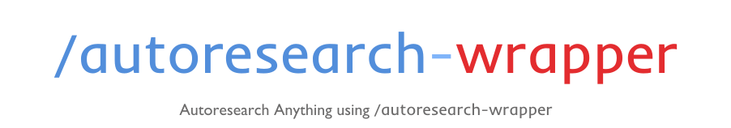
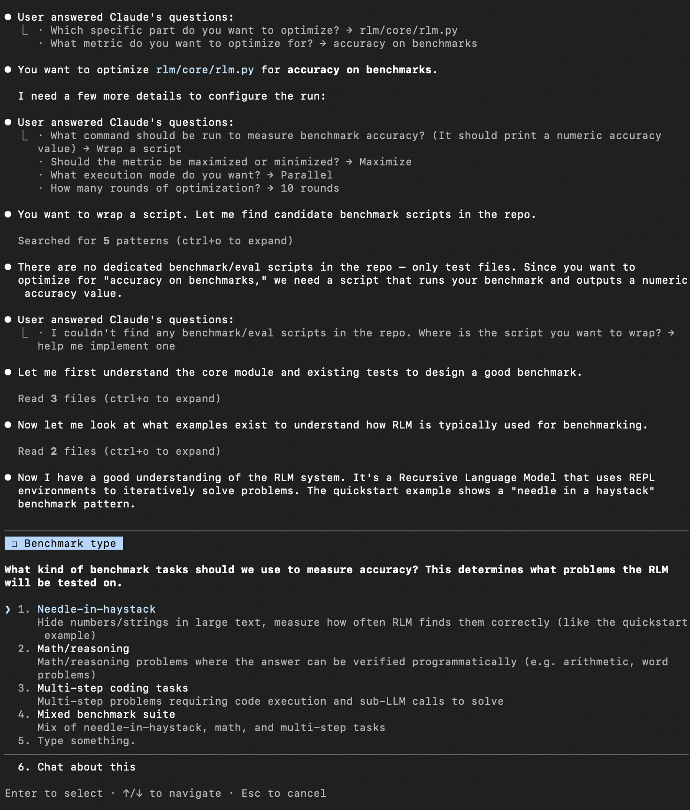

<div align="center">



**Dependency-aware optimization engine for any codebase.**

Scan, plan, isolate, measure, repeat — all in Git worktrees, hands-free.

Inspired by [Karpathy's autoresearch](https://github.com/karpathy/autoresearch) — constraint + mechanical metric + autonomous iteration = compounding gains.

[](https://docs.anthropic.com/en/docs/claude-code)
[](https://platform.openai.com/docs/codex)
[](https://github.com/HenryCai11/autoresearch-wrapper/releases)
[](LICENSE)
[](https://github.com/karpathy/autoresearch)

<br>

*"Just type /autoresearch-wrapper → everything's managed"*

<br>

[Install](#install) · [Usage](#usage) · [Commands](#commands) · [Docs](./DETAILS.md) · [简体中文](./README.zh-CN.md)

</div>

---

Recently, I've been asking Codex to write autoresearch wrappers for the modules that I want to optimize. There's a concrete use case where I want to add a feature or module, and I have several candidates. But each time you add one, you need to optimize all the other related parts to get a sense of how helpful the module is (`autoresearch-wrapper-create`). That's when I wanted to implement a SKILL for this, and I thought that at the very beginning, before optimizing a system, we should understand the dependencies. So here it comes: a Dependency-aware Autoresearch Engine that wraps your modules, scripts, and more.

## News

- 2026/10/15: v0.1.0.
  - `create` / `delete` are now fair comparisons: every approach (or the deletion) and a no-change control arm are tuned with the same budget, then ranked by their tuned ceiling with `compare`.
  - Tuning in those arms is limited to an enforced file scope.
  - Runs now build on kept candidates, stop rules are enforced, and the new `finalize` merges the winner back and cleans up worktrees.
  - Metric timeouts, safe parallel bookkeeping, and many smaller fixes.
  - One skill set now serves both Claude Code and Codex. For Codex, `ln -s /path/to/autoresearch-wrapper/skills/* ~/.agents/skills/` gives you every command as its own skill; the old repo-root install still works as one comprehensive skill.
  - **Breaking:** create/delete runs made with older versions can't be compared; recreate them.
- 2026/03/25: Refreshed the Claude marketplace package so the wizard-first flow and bundled scripts install correctly from the plugin cache.
- 2026/03/23 2:31 AM, Beijing Time: I've decided to release it at v0.0.2! Just feel excited to share it with the community. Although I'm still going through all the features to make sure they are everything I want, I think it is ready to play with.

## Install

<details open>
<summary><b>Claude Code (recommended)</b></summary>

```bash
/plugin marketplace add HenryCai11/autoresearch-wrapper
/plugin install autoresearch-wrapper
```

To update to the latest version:

```bash
/plugin marketplace update autoresearch-wrapper
/plugin update autoresearch-wrapper
```

If you installed an older `0.0.2` marketplace build before the plugin packaging changes, run:

```bash
/plugin marketplace update autoresearch-wrapper
/plugin remove autoresearch-wrapper
/plugin install autoresearch-wrapper
```

To uninstall:

```bash
/plugin remove autoresearch-wrapper
```

Or install manually:

```bash
git clone https://github.com/HenryCai11/autoresearch-wrapper.git
```

Claude Code discovers skills from `.claude/skills/` automatically. To use them in all your projects, symlink the skill folders into your user skills directory:

```bash
mkdir -p ~/.claude/skills
ln -s /path/to/autoresearch-wrapper/skills/* ~/.claude/skills/
```

The marketplace package lives under `plugins/autoresearch-wrapper/` and is generated from `skills/`.

</details>

<details>
<summary><b>Codex</b></summary>

Codex reads the same skill folders. Inside this repo they are picked up from `.agents/skills/`. To use them everywhere:

```bash
mkdir -p ~/.agents/skills
ln -s /path/to/autoresearch-wrapper/skills/* ~/.agents/skills/
```

Invoke skills with `$autoresearch-wrapper`, `$autoresearch-wrapper-run`, and so on (or pick from `/skills`). Restart Codex after installing.

Alternatively, install the repo root as one comprehensive skill (`ln -s /path/to/autoresearch-wrapper ~/.agents/skills/autoresearch-wrapper`); the root `SKILL.md` covers every command. The older `~/.codex/skills/autoresearch-wrapper` install keeps working the same way. Pick one style: both provide a skill named `autoresearch-wrapper`.

</details>

<details>
<summary><b>CLI only</b></summary>

No installation needed — run directly:

```bash
python3 scripts/autoresearch_wrapper.py scan
```

</details>

## Usage

Just run
```
/autoresearch-wrapper
```
This starts a wizard that begins with a compact core-functionality scan, then guides you step-by-step through target selection and run setup. If you want the full repo-wide listing, use `python3 scripts/autoresearch_wrapper.py wizard --full-summary`.

## Examples

An example of the wizard for optimizing [Recursive Language Models](https://github.com/alexzhang13/rlm)



## Commands

One skill set serves both tools: invoke a skill as `/<skill>` in Claude Code or `$<skill>` in Codex.

| Skill | CLI | What it does |
| --- | --- | --- |
| `autoresearch-wrapper` | `wizard` / `wrap` | Run the end-to-end wizard or wrap a script |
| `autoresearch-wrapper-status` | `status` | Show state and readiness |
| `autoresearch-wrapper-run` | `run` | Start or resume a run |
| `autoresearch-wrapper-flow` | `flow` | Metric history and plot |
| `autoresearch-wrapper-create` | `create` | Compare feature approaches, each tuned vs. a tuned control |
| `autoresearch-wrapper-delete` | `delete` | Compare deleting a part vs. keeping it, both tuned |
| `autoresearch-wrapper-monitor` | `monitor` | Progress snapshots (the CLI poller is for terminals) |

Additional CLI subcommands: `scan`, `configure`, `allocate`, `evaluate`, `record`, `arm-ready`, `compare`, `finalize`, `preset-metric`

When a run ends, `finalize --run-id <id> --merge` squash-merges the best candidate into your checkout (staged for review, not committed) and removes the run's worktrees.

## Testing

```bash
python3 -m unittest -q
```

## Documentation

| Doc | Contents |
| --- | --- |
| [DETAILS.md](./DETAILS.md) | Feature details, dependency graph notes, generated layout, typical workflow |
| [CORE_FEATURES.md](./CORE_FEATURES.md) | Feature checklist (Chinese) |
| [CONTRIBUTING.md](./CONTRIBUTING.md) | Development workflow, branch layout, verification |
| [THIRD_PARTY_NOTICES.md](./THIRD_PARTY_NOTICES.md) | Upstream attribution |


## Acknowledgment

I'm inspired by several autoresearch projects. They are [Karpathy's autoresearch](https://github.com/karpathy/autoresearch), and [uditgoenka's autoresearch](https://github.com/uditgoenka/autoresearch). Thanks!
